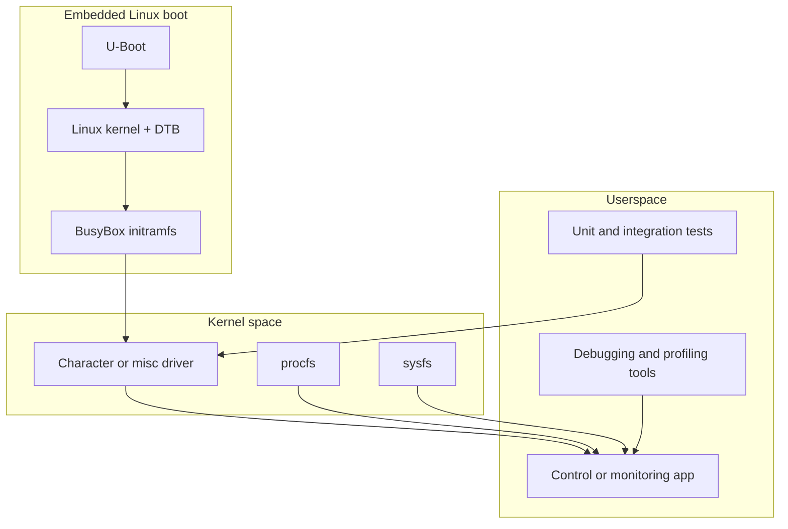

# LOS201 — Embedded Linux Systems Portfolio

**Student:** Huynh Tri Phat<br>
**Student ID:** SE205208<br>
**Course:** LOS201 — Embedded Linux Systems<br>
**Primary target:** ARMv7-A Cortex-A9 on QEMU `vexpress-a9`

This repository contains laboratory work, Linux kernel modules, userspace test
programs, debugging evidence, and a multithreaded Sensor Monitoring System.
It is organized as a technical portfolio that another student or reviewer can
navigate, build, test, and discuss.

The repository includes historical binaries and logs. Those files show prior
work, but they do not prove that the current source still builds. Current
validation status is stated explicitly as **PASS**, **FAIL**, **NOT RUN**, or
**BLOCKED**.

---

## Table of contents

- [Learning objectives](#learning-objectives)
- [Development environment](#development-environment)
- [Repository structure](#repository-structure)
- [Coverage summary](#coverage-summary)
- [LAB01 — Embedded Linux boot](#lab01--embedded-linux-boot)
- [LAB02 — Character devices and filesystems](#lab02--character-devices-and-filesystems)
- [Twenty incremental driver lessons](#twenty-incremental-driver-lessons)
- [LAB03 — Debugging and performance](#lab03--debugging-and-performance)
- [ASSIGNMENT01 — ioctl and misc devices](#assignment01--ioctl-and-misc-devices)
- [ASSIGNMENT02 — Sensor Monitoring System](#assignment02--sensor-monitoring-system)
- [System architecture](#system-architecture)
- [Quick start](#quick-start)
- [Build and execution guide](#build-and-execution-guide)
- [Testing and validation](#testing-and-validation)
- [Evidence policy](#evidence-policy)
- [Known limitations](#known-limitations)
- [Troubleshooting](#troubleshooting)
- [Documentation index](#documentation-index)
- [Provenance and attribution](#provenance-and-attribution)
- [Learning outcomes](#learning-outcomes)
- [References](#references)
- [Project status](#project-status)

---

## Learning objectives

This portfolio demonstrates work toward these LOS201 outcomes:

- Configure and cross-compile Linux software for ARMv7-A.
- Explain U-Boot, Linux kernel, Device Tree, initramfs, and BusyBox boot flow.
- Build Linux kernel modules with Kbuild.
- Implement character and misc device drivers.
- Design correct `open`, `read`, `write`, `release`, `llseek`, and `ioctl` behavior.
- Transfer data safely with `copy_to_user` and `copy_from_user`.
- Expose driver state through procfs and sysfs.
- Protect shared state with mutexes, condition variables, and atomic flags.
- Implement bounded producer-consumer communication.
- Use POSIX threads and message queues.
- Diagnose programs with GDB, Valgrind, strace, and perf.
- Interpret scheduling latency without claiming unsupported real-time guarantees.
- Preserve commands, logs, source commits, and environment data as evidence.

---

## Development environment

| Component | Intended environment |
|---|---|
| Host OS | Ubuntu or another compatible Linux distribution |
| Target architecture | ARMv7-A Cortex-A9 |
| Emulator | QEMU Versatile Express `vexpress-a9` |
| Kernel family | Linux 5.15-compatible course environment |
| Cross-compiler | `arm-linux-gnueabihf-` |
| Userspace | BusyBox initramfs |
| Kernel build | Kbuild with a configured target kernel tree |
| Application APIs | POSIX threads, message queues, file I/O, scheduling |
| Debugging tools | GDB, Valgrind, strace, perf, cyclictest |

The exact kernel source, compiler, QEMU, BusyBox, and U-Boot versions must be
recorded for each new validation run. See
[`docs/ENVIRONMENT_SETUP.md`](docs/ENVIRONMENT_SETUP.md).

> Current upgrade environment: Windows without WSL, GCC, Make, QEMU,
> ShellCheck, Valgrind, or an ARM cross-toolchain. Linux builds and runtime
> tests are therefore marked **BLOCKED**, not PASS.

---

## Repository structure

```text
.
├── LAB01/                 Embedded Linux boot documentation and QEMU launcher
├── LAB02/                 Historical LAB02 sensor-driver snapshot
├── LA02_20LESSON/         Twenty incremental character-driver exercises
├── LAB03/                 Debugging, profiling, and latency experiments
├── ASSIGNMENT01/          ioctl driver and misc device driver
├── ASSIGNMENT02/          Sensor Monitoring System driver, app, tests, logs
├── docs/                  Architecture, setup, testing, audit, provenance
├── scripts/               Safe repository validation utilities
├── HANDOFF.md             Work completed, commands, blockers, next steps
└── README.md              Portfolio landing page
```

The historical name `LA02_20LESSON` is retained to avoid breaking links and
Git history. `LAB02` overlaps with part of `ASSIGNMENT02`; both remain until a
provenance-safe consolidation decision is made.

---

## Coverage summary

| Area | Main topics | Source status | Current verification |
|---|---|---|---|
| [LAB01](LAB01/README.md) | kernel, U-Boot, DTB, BusyBox, initramfs, QEMU | documented scaffold | BLOCKED: build and boot tools absent |
| [LAB02](LAB02/README.md) | character drivers and filesystem scope | partial historical snapshot | NOT RUN |
| [20 lessons](LA02_20LESSON/README.md) | read/write, procfs, sysfs, mutex, EOF, ioctl | 20 exercises present | NOT RUN against a kernel |
| [LAB03](LAB03/README.md) | GDB, Valgrind, strace, perf, cyclictest | source and historical logs present | historical evidence only |
| [ASSIGNMENT01](ASSIGNMENT01/README.md) | ioctl ABI and misc device | source present | BLOCKED: ARM/kernel toolchain absent |
| [ASSIGNMENT02](ASSIGNMENT02/README.md) | driver, threads, circular buffer, IPC, logging | source and unit tests present | BLOCKED: Linux/GCC/Make absent |

Detailed topic coverage appears in
[`docs/audit/COVERAGE_MATRIX.md`](docs/audit/COVERAGE_MATRIX.md).

---

## LAB01 — Embedded Linux boot

### Scope

- Configure and cross-compile a Linux kernel for ARM.
- Explain the role of U-Boot before the Linux kernel starts.
- Explain how the DTB describes the emulated hardware.
- Build a BusyBox root filesystem and initramfs.
- Boot `vexpress-a9` with a serial console.
- Diagnose kernel panic, missing init, wrong console, and bad DTB failures.

### Boot flow

```mermaid
flowchart LR
    Reset[QEMU reset] --> UBoot[U-Boot]
    UBoot --> Kernel[Linux zImage]
    UBoot --> DTB[Device Tree Blob]
    Kernel --> Initramfs[BusyBox initramfs]
    Initramfs --> Init[/init]
    Init --> Shell[BusyBox shell]
```

### Repository files

- [`LAB01/README.md`](LAB01/README.md) — complete build outline and diagnosis table.
- [`LAB01/scripts/boot-linux-qemu.sh`](LAB01/scripts/boot-linux-qemu.sh) — guarded QEMU launcher.

The launcher requires `KERNEL_IMAGE`, `DTB_IMAGE`, and `INITRAMFS_IMAGE`. It
checks that every artifact is readable before starting QEMU.

### Current result

- Boot documentation: **PASS**.
- Launcher Bash syntax: **PASS**.
- Kernel build: **BLOCKED**.
- U-Boot build: **BLOCKED**.
- BusyBox/initramfs build: **BLOCKED**.
- QEMU boot to shell: **BLOCKED**.

Browse: [`LAB01/`](LAB01/)

---

## LAB02 — Character devices and filesystems

### Scope

- Linux kernel module lifecycle and Kbuild.
- Character-device registration and cleanup.
- `open`, `read`, `write`, `release`, and file offsets.
- `copy_to_user` and `copy_from_user` trust boundaries.
- procfs and sysfs interfaces.
- Mutex-protected driver state.
- ioctl command validation and errno behavior.
- MTD/JFFS2 when required by the course specification.

### Repository files

- [`LAB02/README.md`](LAB02/README.md)
- [`LAB02/driver/Makefile`](LAB02/driver/Makefile)
- [`LAB02/driver/sms_sensor.h`](LAB02/driver/sms_sensor.h)
- [`LAB02/driver/sms_sensor_driver.c`](LAB02/driver/sms_sensor_driver.c)
- [`LAB02/logs/`](LAB02/logs/)
- [`LAB02/output/`](LAB02/output/)

### Current result

The directory contains a historical sensor-driver snapshot that overlaps with
`ASSIGNMENT02`. It is preserved to avoid deleting academic evidence.

- Driver source present: **PASS**.
- Configurable `KDIR`, `ARCH`, and `CROSS_COMPILE`: **PASS**.
- Fresh module compilation: **BLOCKED**.
- MTD/JFFS2 implementation: **INCOMPLETE**.
- Runtime module tests: **NOT RUN**.

Browse: [`LAB02/`](LAB02/)

---

## Twenty incremental driver lessons

`LA02_20LESSON` separates driver concepts into small exercises. Each lesson
contains a `Makefile`, driver source, README, and privileged guest test script.

| Lesson | Topic | Directory |
|---:|---|---|
| 01 | Count successful reads | [`LESSON01_READ_COUNT`](LA02_20LESSON/LESSON01_READ_COUNT/) |
| 02 | Count successful writes | [`LESSON02_WRITE_COUNT`](LA02_20LESSON/LESSON02_WRITE_COUNT/) |
| 03 | Clear the device buffer | [`LESSON03_CLEAR_BUFFER`](LA02_20LESSON/LESSON03_CLEAR_BUFFER/) |
| 04 | Limit writes to 128 bytes | [`LESSON04_WRITE_LIMIT_128`](LA02_20LESSON/LESSON04_WRITE_LIMIT_128/) |
| 05 | Expose buffer size | [`LESSON05_BUFFER_SIZE`](LA02_20LESSON/LESSON05_BUFFER_SIZE/) |
| 06 | Expose buffer status | [`LESSON06_BUFFER_STATUS`](LA02_20LESSON/LESSON06_BUFFER_STATUS/) |
| 07 | Count total bytes read | [`LESSON07_TOTAL_BYTES_READ`](LA02_20LESSON/LESSON07_TOTAL_BYTES_READ/) |
| 08 | Count total bytes written | [`LESSON08_TOTAL_BYTES_WRITTEN`](LA02_20LESSON/LESSON08_TOTAL_BYTES_WRITTEN/) |
| 09 | Record last-write time | [`LESSON09_LAST_WRITE_TIMESTAMP`](LA02_20LESSON/LESSON09_LAST_WRITE_TIMESTAMP/) |
| 10 | Expose driver version | [`LESSON10_DRIVER_VERSION`](LA02_20LESSON/LESSON10_DRIVER_VERSION/) |
| 11 | Reset statistics | [`LESSON11_RESET_STATISTICS`](LA02_20LESSON/LESSON11_RESET_STATISTICS/) |
| 12 | Count open handles safely | [`LESSON12_SAFE_OPEN_COUNT`](LA02_20LESSON/LESSON12_SAFE_OPEN_COUNT/) |
| 13 | Protect reads with a mutex | [`LESSON13_READ_MUTEX`](LA02_20LESSON/LESSON13_READ_MUTEX/) |
| 14 | Append instead of replace | [`LESSON14_APPEND_MODE`](LA02_20LESSON/LESSON14_APPEND_MODE/) |
| 15 | Clear on newline command | [`LESSON15_CLEAR_NEWLINE`](LA02_20LESSON/LESSON15_CLEAR_NEWLINE/) |
| 16 | Configure maximum buffer size | [`LESSON16_CONFIGURABLE_MAX_SIZE`](LA02_20LESSON/LESSON16_CONFIGURABLE_MAX_SIZE/) |
| 17 | Report last-write size | [`LESSON17_LAST_WRITE_SIZE`](LA02_20LESSON/LESSON17_LAST_WRITE_SIZE/) |
| 18 | Aggregate procfs statistics | [`LESSON18_FULL_PROC_STATS`](LA02_20LESSON/LESSON18_FULL_PROC_STATS/) |
| 19 | Implement read-once EOF behavior | [`LESSON19_READ_ONCE`](LA02_20LESSON/LESSON19_READ_ONCE/) |
| 20 | Control the driver through ioctl | [`LESSON20_IOCTL_CONTROLS`](LA02_20LESSON/LESSON20_IOCTL_CONTROLS/) |

### Safety note

The lesson test scripts call `sudo insmod`. Run them only after code review in
a disposable Linux VM or matching QEMU guest. Repository CI must not load
training modules into an arbitrary runner kernel.

### Missing extensions

- Exercise 21 — minimum/maximum sensor temperature: **INCOMPLETE**.
- Exercise 22 — circular-buffer interaction with userspace: **INCOMPLETE**.

These exercises were not copied from the comparison repository. They require
an authoritative syllabus or independently reviewed specification.

Browse: [`LA02_20LESSON/`](LA02_20LESSON/)

---

## LAB03 — Debugging and performance

### Scope

- Use GDB to inspect program state and backtraces.
- Detect invalid memory access and leaks with Valgrind.
- Trace userspace/kernel interactions with strace.
- Measure CPU event samples and hotspots with perf.
- Observe scheduling latency with cyclictest.
- Distinguish observed results from real-time guarantees.

### Main application sources

- [`LAB03/apps/buggy_app.c`](LAB03/apps/buggy_app.c)
- [`LAB03/apps/leaky_app.c`](LAB03/apps/leaky_app.c)
- [`LAB03/apps/leaky_app_fixed.c`](LAB03/apps/leaky_app_fixed.c)
- [`LAB03/apps/leaky_app_arm_measure.c`](LAB03/apps/leaky_app_arm_measure.c)
- [`LAB03/apps/perf_target.c`](LAB03/apps/perf_target.c)
- [`LAB03/apps/debug_bug1.gdb`](LAB03/apps/debug_bug1.gdb)

### Historical evidence

- [`LAB03/logs/gdb_bug1.txt`](LAB03/logs/gdb_bug1.txt)
- [`LAB03/logs/gdb_bug2_3.txt`](LAB03/logs/gdb_bug2_3.txt)
- [`LAB03/logs/valgrind_report.txt`](LAB03/logs/valgrind_report.txt)
- [`LAB03/logs/valgrind_fixed.txt`](LAB03/logs/valgrind_fixed.txt)
- [`LAB03/logs/strace_summary.txt`](LAB03/logs/strace_summary.txt)
- [`LAB03/logs/perf_report_verified.txt`](LAB03/logs/perf_report_verified.txt)
- [`LAB03/logs/hist_standard.txt`](LAB03/logs/hist_standard.txt)
- [`LAB03/logs/hist_under_load.txt`](LAB03/logs/hist_under_load.txt)
- [`LAB03/logs/latency_histogram.png`](LAB03/logs/latency_histogram.png)

### Evidence interpretation

| Tool | What the result can demonstrate | What it cannot prove alone |
|---|---|---|
| GDB | observed control flow and variable state | correctness on unexecuted paths |
| Valgrind | memory defects on executed paths | absence of every possible defect |
| strace | observed system-call sequence | internal algorithm correctness |
| perf | sampled events under one workload | universal CPU performance |
| cyclictest | observed scheduling latency | a hard real-time guarantee |

Current status: source and logs are present, but the current commit was not
rebuilt or rerun during this Windows-based upgrade.

Browse: [`LAB03/`](LAB03/)

---

## ASSIGNMENT01 — ioctl and misc devices

### Task 1: ioctl character driver

The driver implements:

- Character-device registration.
- Read/write behavior with a bounded internal buffer.
- Mutex-protected statistics.
- Buffer reset through ioctl.
- Statistics retrieval through ioctl.
- Operating-mode selection through ioctl.
- Driver-version retrieval through ioctl.
- procfs status and sysfs attributes.
- Userspace control application and negative ioctl test.

Main files:

- [`ASSIGNMENT01/task1_ioctl/Makefile`](ASSIGNMENT01/task1_ioctl/Makefile)
- [`ASSIGNMENT01/task1_ioctl/asgn1_driver.c`](ASSIGNMENT01/task1_ioctl/asgn1_driver.c)
- [`ASSIGNMENT01/task1_ioctl/asgn1_ioctl.h`](ASSIGNMENT01/task1_ioctl/asgn1_ioctl.h)
- [`ASSIGNMENT01/task1_ioctl/asgn1_ctl.c`](ASSIGNMENT01/task1_ioctl/asgn1_ctl.c)
- [`ASSIGNMENT01/task1_ioctl/test_asgn1.sh`](ASSIGNMENT01/task1_ioctl/test_asgn1.sh)

### Task 2: misc device

Main files:

- [`ASSIGNMENT01/task2_misc/Makefile`](ASSIGNMENT01/task2_misc/Makefile)
- [`ASSIGNMENT01/task2_misc/counter_driver.c`](ASSIGNMENT01/task2_misc/counter_driver.c)
- [`ASSIGNMENT01/task2_misc/test_counter.sh`](ASSIGNMENT01/task2_misc/test_counter.sh)

### Historical evidence

- [`ASSIGNMENT01/logs/dmesg_full.txt`](ASSIGNMENT01/logs/dmesg_full.txt)
- [`ASSIGNMENT01/logs/qemu_session.txt`](ASSIGNMENT01/logs/qemu_session.txt)
- [`ASSIGNMENT01/logs/test_asgn1_output.txt`](ASSIGNMENT01/logs/test_asgn1_output.txt)
- [`ASSIGNMENT01/logs/test_counter_output.txt`](ASSIGNMENT01/logs/test_counter_output.txt)

### Build

```bash
make -C ASSIGNMENT01/task1_ioctl \
  KDIR=/opt/linux-5.15 \
  ARCH=arm \
  CROSS_COMPILE=arm-linux-gnueabihf-

make -C ASSIGNMENT01/task2_misc \
  KDIR=/opt/linux-5.15 \
  ARCH=arm \
  CROSS_COMPILE=arm-linux-gnueabihf-
```

Current result: source review and configurable Makefiles **PASS**. Fresh module
build and QEMU execution are **BLOCKED** in the current environment.

Browse: [`ASSIGNMENT01/`](ASSIGNMENT01/)

---

## ASSIGNMENT02 — Sensor Monitoring System

This assignment combines a simulated kernel sensor, a multithreaded userspace
pipeline, bounded storage, POSIX message queues, logging, alert processing, and
scheduling experiments.

### Part A: kernel sensor driver

The driver provides:

- `/dev/sms_sensor` through a misc device.
- CSV samples containing timestamp, temperature, and humidity.
- `/proc/sms_stats` statistics.
- `SMS_SET_INTERVAL` ioctl configuration.
- `-EAGAIN` when the configured sampling interval has not elapsed.
- Mutex protection for shared state.
- Reverse-order cleanup for procfs and misc-device resources.

Main files:

- [`ASSIGNMENT02/driver/Makefile`](ASSIGNMENT02/driver/Makefile)
- [`ASSIGNMENT02/driver/sms_sensor.h`](ASSIGNMENT02/driver/sms_sensor.h)
- [`ASSIGNMENT02/driver/sms_sensor_driver.c`](ASSIGNMENT02/driver/sms_sensor_driver.c)
- [`ASSIGNMENT02/tests/test_ioctl.c`](ASSIGNMENT02/tests/test_ioctl.c)

### Part B: multithreaded application

| Component | Responsibility |
|---|---|
| Sensor thread | read real CSV samples or generate mock samples periodically |
| Circular buffer | bounded producer-consumer storage with synchronization |
| Processor thread | rolling averages, thresholds, and spike detection |
| Alert thread | consume alarms and forward alert logs |
| Logger thread | timestamped records, periodic flush, and log rotation |
| Main application | configuration, startup, shutdown, queues, summaries |

Application files:

- [`ASSIGNMENT02/app/src/sms_app.c`](ASSIGNMENT02/app/src/sms_app.c)
- [`ASSIGNMENT02/app/src/sensor_thread.c`](ASSIGNMENT02/app/src/sensor_thread.c)
- [`ASSIGNMENT02/app/src/circular_buffer.c`](ASSIGNMENT02/app/src/circular_buffer.c)
- [`ASSIGNMENT02/app/src/processor_thread.c`](ASSIGNMENT02/app/src/processor_thread.c)
- [`ASSIGNMENT02/app/src/alert_thread.c`](ASSIGNMENT02/app/src/alert_thread.c)
- [`ASSIGNMENT02/app/src/logger_thread.c`](ASSIGNMENT02/app/src/logger_thread.c)
- [`ASSIGNMENT02/app/include/`](ASSIGNMENT02/app/include/)

### Unit tests

- [`test_sensor.c`](ASSIGNMENT02/app/tests/test_sensor.c) — CSV parsing and mock acquisition.
- [`test_processor.c`](ASSIGNMENT02/app/tests/test_processor.c) — alarms, averages, buffer drain.
- [`test_alert.c`](ASSIGNMENT02/app/tests/test_alert.c) — queue delivery and alert counters.
- [`test_logger.c`](ASSIGNMENT02/app/tests/test_logger.c) — flush behavior and rotation.

### Data flow

```mermaid
flowchart LR
    Device[/dev/sms_sensor] --> Sensor[Sensor thread]
    Mock[Mock source] --> Sensor
    Sensor --> Ring[Circular buffer]
    Ring --> Processor[Processor thread]
    Processor --> AlarmQ[POSIX alarm queue]
    Processor --> LogQ[POSIX log queue]
    AlarmQ --> Alert[Alert thread]
    Alert --> LogQ
    LogQ --> Logger[Logger thread]
    Logger --> File[Rotating log file]
```

### Shutdown order

1. Set the atomic stop request.
2. Join the sensor thread.
3. Stop the circular buffer and let the processor drain pending samples.
4. Send bounded shutdown messages to alert and logger queues.
5. Join consumer threads.
6. Close and unlink message queues.
7. Destroy the circular buffer and release allocated memory.

### Host build and test

```bash
make -C ASSIGNMENT02/app clean host tests
make -C ASSIGNMENT02/app test
./ASSIGNMENT02/app/bin/sms_app_x86 --mock --duration 5
```

### ARM build

```bash
make -C ASSIGNMENT02/app arm ARM_CC=arm-linux-gnueabihf-gcc
make -C ASSIGNMENT02/driver \
  KDIR=/opt/linux-5.15 \
  ARCH=arm \
  CROSS_COMPILE=arm-linux-gnueabihf- arm
```

### Current result

| Check | Status |
|---|---|
| Driver and application source present | PASS |
| Four unit-test sources present | PASS |
| Host/test Makefile targets present | PASS |
| Fresh host compile | BLOCKED |
| Fresh unit-test execution | BLOCKED |
| AddressSanitizer/UBSan run | BLOCKED |
| ARM cross-build | BLOCKED |
| QEMU driver integration | NOT RUN |
| Queue-saturation stress test | NOT RUN |

Historical logs are stored under [`ASSIGNMENT02/logs/`](ASSIGNMENT02/logs/).
They must not be reported as current PASS results without reproduction.

Browse: [`ASSIGNMENT02/`](ASSIGNMENT02/)

---

## System architecture



Detailed lifecycle, ioctl, ownership, and threading diagrams are in
[`docs/ARCHITECTURE.md`](docs/ARCHITECTURE.md).

---

## Quick start

### 1. Clone and inspect

```bash
git clone https://github.com/huynhtriphat01-star/LOS201-SE205208-HuynhTriPhat.git
cd LOS201-SE205208-HuynhTriPhat
git status
```

### 2. Run safe repository checks

```bash
./scripts/verify.sh
```

This command checks local Markdown targets and Bash syntax. ShellCheck runs
only when installed. It never runs `sudo`, `insmod`, or QEMU.

### 3. Build safe userspace targets on Linux

```bash
make -C ASSIGNMENT02/app clean host tests
make -C ASSIGNMENT02/app test
```

### 4. Run the application with mock data

```bash
./ASSIGNMENT02/app/bin/sms_app_x86 --mock --duration 5
```

### 5. Move to ARM/QEMU only after host checks pass

Set the target kernel tree, toolchain prefix, and artifact paths explicitly.
Do not rely on personal home-directory paths.

---

## Build and execution guide

| Workload | Environment | Root required? |
|---|---|---:|
| Markdown and Bash checks | Windows with Git Bash or Linux | No |
| Assignment 02 mock application | Linux host | No |
| Assignment 02 unit tests | Linux host | No |
| ARM userspace build | Linux host with cross-toolchain | No |
| Kernel module build | Linux host with configured kernel tree | No |
| QEMU boot | Linux host with QEMU and artifacts | No |
| Module load/test | Disposable Linux/QEMU guest | Yes |

Full commands: [`docs/BUILD_AND_RUN.md`](docs/BUILD_AND_RUN.md).

---

## Testing and validation

### Checks completed during portfolio upgrade

| Command | Result |
|---|---|
| `python scripts/check_markdown_links.py --self-test` | PASS |
| `python scripts/check_markdown_links.py .` | PASS after this README expansion |
| `bash scripts/verify.sh` | PASS for links and 24 Bash files; ShellCheck BLOCKED |
| `git diff --check` | PASS after this README expansion |

### Checks blocked in current environment

- Assignment 02 host compilation and unit tests.
- AddressSanitizer and UndefinedBehaviorSanitizer.
- ARM userspace cross-compilation.
- Linux kernel module compilation.
- QEMU boot and module integration.
- Valgrind, strace, perf, and cyclictest reproduction.

The full matrix and result-label policy are in
[`docs/TESTING.md`](docs/TESTING.md).

---

## Evidence policy

A test is current only when its record includes:

- Exact command.
- Source commit SHA.
- Operating system and architecture.
- Compiler or tool version.
- Relevant kernel configuration and version.
- Exit status.
- Complete raw output or an immutable artifact hash.

Committed `.ko`, executable, initramfs, perf, image, and log files are treated
as historical until reproduced from the current commit.

---

## Known limitations

- No fresh Linux build or QEMU run was possible during this upgrade.
- `LAB02` and `ASSIGNMENT02` contain overlapping historical content.
- Compiled executables, `.ko` files, initramfs archives, backups, and logs remain tracked.
- MTD/JFFS2 course coverage is incomplete in this repository.
- Exercises 21 and 22 are not implemented.
- Some historical logs do not contain complete tool and source metadata.
- Exact file matches with the comparison repository require attribution review.
- No broad software license was added because third-party rights are unresolved.

Ranked issues and verification gates are in
[`docs/audit/TECHNICAL_DEBT.md`](docs/audit/TECHNICAL_DEBT.md).

---

## Troubleshooting

| Symptom | Likely cause | First check |
|---|---|---|
| Kernel build directory missing | wrong or unset `KDIR` | target kernel build tree exists |
| `Exec format error` during `insmod` | wrong architecture or vermagic | `file`, `modinfo`, `uname -r` |
| QEMU shows no serial output | wrong console or machine | `-M vexpress-a9`, `console=ttyAMA0` |
| `No working init found` | invalid initramfs `/init` | mode, shebang, dynamic loader |
| `mq_open: Invalid argument` | guest queue limits | `/proc/sys/fs/mqueue/*` |
| FIFO scheduling denied | missing privilege/capability | use normal scheduling or required capability |
| Device read returns EOF | file offset reached end | reopen or use supported seek behavior |
| Device read returns `EAGAIN` | sample interval not elapsed | wait or adjust interval through ioctl |

More cases: [`docs/TROUBLESHOOTING.md`](docs/TROUBLESHOOTING.md).

---

## Documentation index

- [`docs/ARCHITECTURE.md`](docs/ARCHITECTURE.md) — boot, driver, ioctl, and thread architecture.
- [`docs/ENVIRONMENT_SETUP.md`](docs/ENVIRONMENT_SETUP.md) — dependencies and version capture.
- [`docs/BUILD_AND_RUN.md`](docs/BUILD_AND_RUN.md) — host, ARM, module, and QEMU commands.
- [`docs/TESTING.md`](docs/TESTING.md) — test layers and result classification.
- [`docs/TROUBLESHOOTING.md`](docs/TROUBLESHOOTING.md) — failure diagnosis.
- [`docs/LEARNING_GUIDE.md`](docs/LEARNING_GUIDE.md) — study and interview path.
- [`docs/PROVENANCE.md`](docs/PROVENANCE.md) — evidence and attribution boundaries.
- [`docs/audit/REPOSITORY_COMPARISON.md`](docs/audit/REPOSITORY_COMPARISON.md) — fixed-commit comparison.
- [`docs/audit/COVERAGE_MATRIX.md`](docs/audit/COVERAGE_MATRIX.md) — topic coverage and gates.
- [`docs/audit/TECHNICAL_DEBT.md`](docs/audit/TECHNICAL_DEBT.md) — ranked defects.
- [`docs/audit/PROVENANCE_REVIEW.md`](docs/audit/PROVENANCE_REVIEW.md) — exact Git blob analysis.
- [`docs/FINAL_VALIDATION_REPORT.md`](docs/FINAL_VALIDATION_REPORT.md) — upgrade validation report.
- [`HANDOFF.md`](HANDOFF.md) — commands, blockers, commits, and next milestone.

---

## Provenance and attribution

The portfolio was compared with
[`hoangtrkhanh/LOS201_Lab`](https://github.com/hoangtrkhanh/LOS201_Lab) at a
fixed commit. The comparison was used to identify topic gaps and byte-identical
Git objects. It was not treated as an authority for correctness or permission
to copy.

The audit found 70 unique blob IDs present in both checked commits. An identical
blob proves identical bytes only. It does not prove who created the content,
the direction of sharing, collaboration terms, or authorization.

See [`docs/PROVENANCE.md`](docs/PROVENANCE.md) and
[`docs/audit/PROVENANCE_REVIEW.md`](docs/audit/PROVENANCE_REVIEW.md).

---

## Learning outcomes

After reviewing this repository, the author should be able to explain:

- The complete boot path from QEMU reset to a BusyBox shell.
- Why Device Tree data and executable firmware have different roles.
- How Kbuild compiles an out-of-tree module against a target kernel.
- Why kernel code must validate userspace pointers and lengths.
- How file position affects partial reads and EOF behavior.
- How ioctl command numbers form an ABI contract.
- Why initialization cleanup runs in reverse acquisition order.
- How mutexes and condition variables coordinate a circular buffer.
- How POSIX message queues introduce bounded backpressure.
- How a multithreaded application shuts down without abandoning resources.
- What GDB, Valgrind, strace, perf, and cyclictest each demonstrate.
- Why one measured latency run cannot prove hard real-time behavior.
- Why historical binaries and logs must be tied to reproducible source metadata.

---

## References

- [Linux kernel documentation](https://docs.kernel.org/)
- [Linux driver API](https://docs.kernel.org/driver-api/)
- [Linux kernel labs](https://linux-kernel-labs.github.io/refs/heads/master/)
- [QEMU ARM system emulator](https://www.qemu.org/docs/master/system/target-arm.html)
- [BusyBox documentation](https://busybox.net/downloads/BusyBox.html)
- [U-Boot documentation](https://docs.u-boot.org/)
- [GNU GDB documentation](https://sourceware.org/gdb/documentation/)
- [Valgrind documentation](https://valgrind.org/docs/)
- [perf wiki](https://perf.wiki.kernel.org/)

---

## Project status

**Overall assessment: PARTIAL**

The repository now has comprehensive navigation, technical documentation,
configurable build inputs, safe repository checks, and transparent provenance
notes. It is not declared complete because fresh Linux compilation, sanitizer
tests, kernel-module validation, and QEMU boot remain unavailable in the
current environment.

### Recommended next milestone

1. Open the repository in an Ubuntu VM.
2. Install the documented host and ARM toolchains.
3. Run safe checks, Assignment 02 host builds, tests, and sanitizers.
4. Build modules against a pinned Linux 5.15 tree.
5. Boot the pinned kernel and initramfs under QEMU.
6. Reproduce integration logs from the current commit.
7. Resolve duplicate directories and provenance before deleting artifacts.

No remote push is performed automatically. Review the branch and evidence
before merging into `main`.
