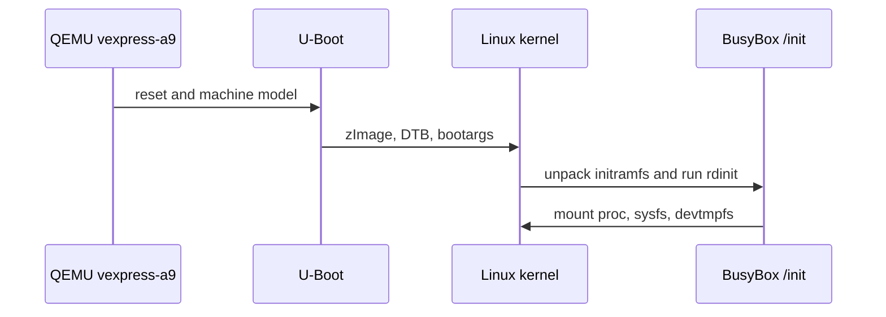
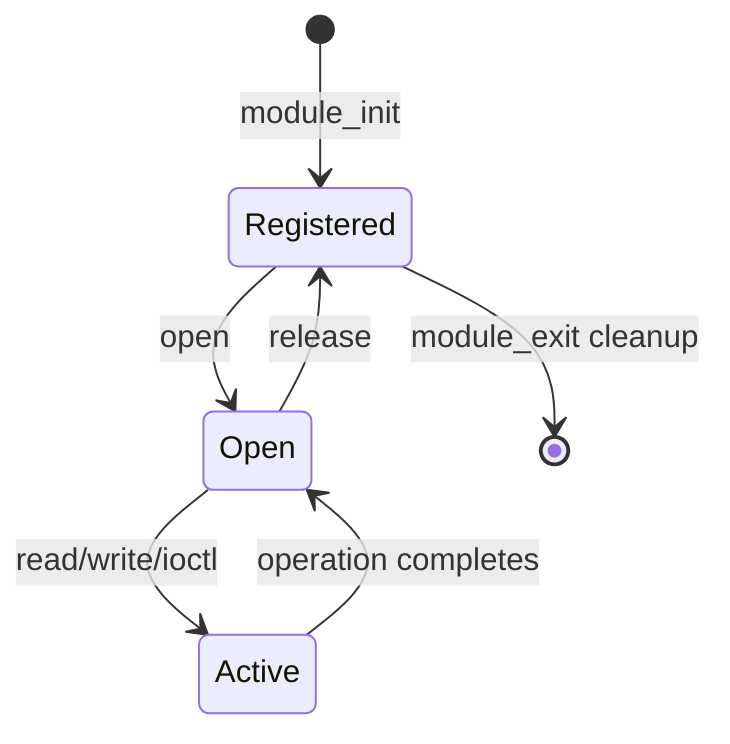
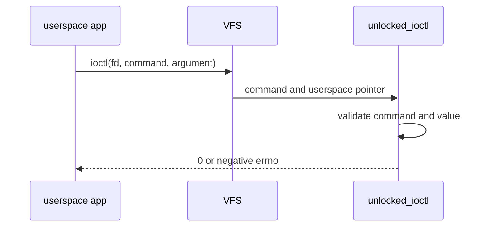
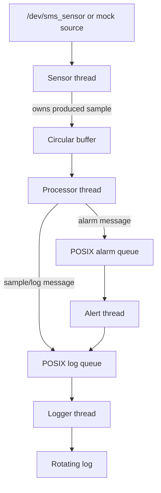

# Architecture

## Boot path

The DTB describes hardware; it is not executable firmware. The kernel matches
drivers to DT nodes, mounts the initramfs, and runs `/init`.

## Character-driver lifecycle

Initialization must unwind resources in reverse order. Userspace pointers cross
the trust boundary only through `copy_to_user` and `copy_from_user`. Shared
state needs locking. Read methods must define offset and EOF behavior.

## ioctl path

Shared headers define ABI numbers and fixed layouts. Unknown commands return
`-ENOTTY`; invalid values return `-EINVAL`; failed copies return `-EFAULT`.

## Sensor Monitoring System

The circular buffer synchronizes producer and consumer access. Queue messages
copy values, avoiding shared heap ownership. Shutdown sets the stop flag,
joins the producer, stops and drains the buffer, sends queue sentinels, joins
consumers, then closes and unlinks queues. Timed sends avoid an infinite stop
wait when a sink queue is full.

Real-time scheduling requests improve priority only when the OS permits them.
Measured latency does not establish a hard real-time guarantee.
